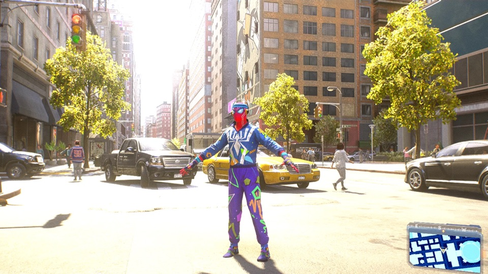
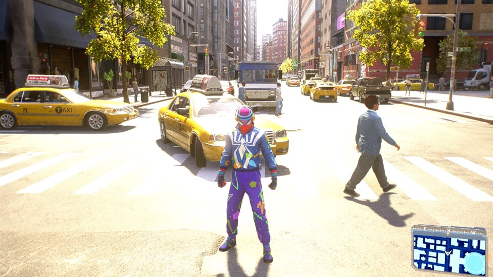
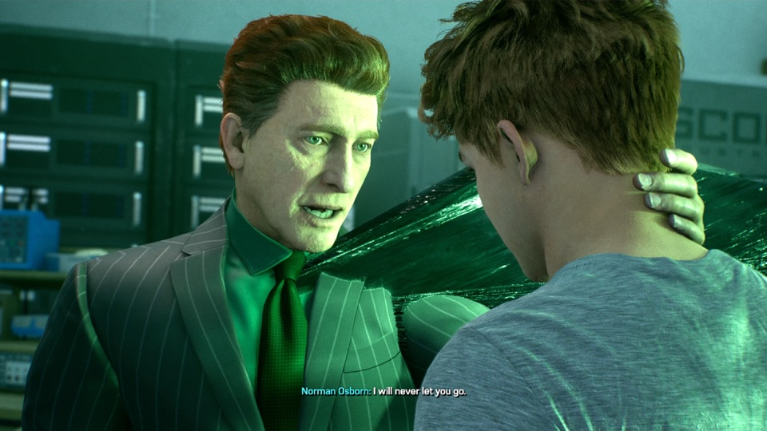
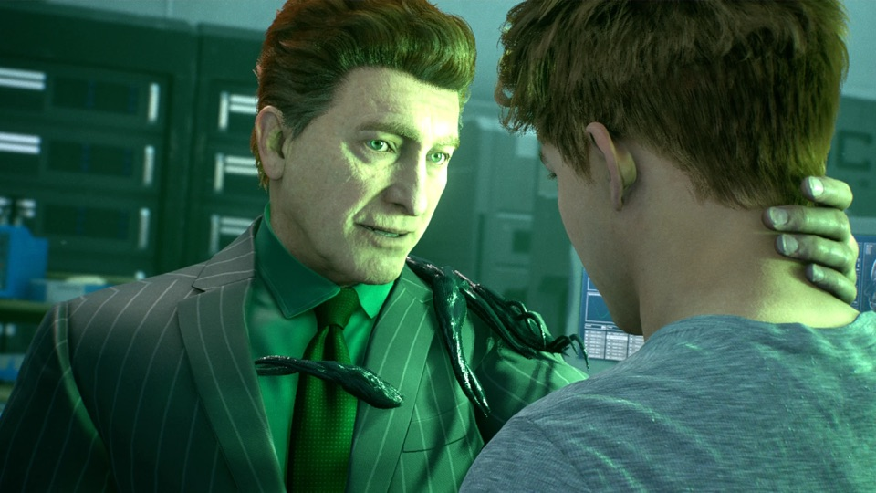
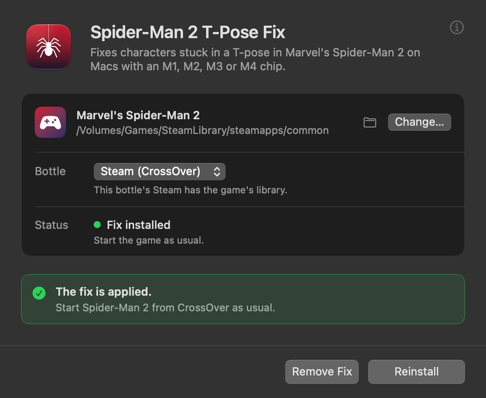

# Spider-Man 2 T-Pose Fix for M1 to M4 Macs (Beta)

Fixes characters stuck in a T-pose, and the symbiote drawn as spikes or a flat black sheet
(or missing), in Marvel's Spider-Man 2 on Macs with an M1, M2, M3 or M4 chip, played through
CrossOver.

| Without the fix | With the fix |
| --- | --- |
|  |  |
|  |  |

## The app

## How to use it

1. [Download the latest release](https://github.com/macprotips/SpiderMan2Fix/releases/latest)
   (`Spider-Man-2-T-Pose-Fix.zip`) and unzip it.
2. Quit Spider-Man 2, then quit Steam inside CrossOver (**Steam › Exit**), then quit
   CrossOver itself (**CrossOver › Quit CrossOver**).
3. Open the app (it's signed and notarized by Apple; macOS asks once whether to open an app
   downloaded from the internet). It finds the game by itself, even in a Steam library on
   an external drive; otherwise drag the **Marvel's Spider-Man 2** folder (the one with
   `Spider-Man2.exe`) into its window.
4. Click **Apply Fix**, then start the game from CrossOver as usual.

**Remove Fix** in the same window puts everything back. If the game updates, the fix
pauses itself until you open the app and click **Update Fix**. Quit Steam and CrossOver
first for these too.

> [!NOTE]
> This fix changes a setting in your CrossOver bottle. CodeWeavers can't support CrossOver
> while the fix is applied. Before contacting CrossOver support, click **Remove Fix** to put
> the bottle back as it was.

## What's wrong, and what the fix does

On M1 to M4 Macs, Apple's D3DMetal (the graphics layer CrossOver uses) returns zeros when a
shader reads a "typed" buffer past element 268,435,456 (2^28). Spider-Man 2 keeps every
character's mesh in one 2 GB buffer and reads it exactly that way, so characters stored in
its upper half never get animated and stay in a T-pose. Writes past that element are lost
the same way, and the game writes the symbiote's triangles into the upper half of that
buffer every frame, so the symbiote is drawn from leftover data (spikes, a flat black sheet)
or not at all.

The fix makes the game read and write that buffer the "raw" way, which works to the end. The
app puts a small `d3d12.dll`, a settings file and four rewritten shaders in the game folder, and sets
one Wine setting in the bottle (`d3d12 = native,builtin` for Spider-Man2.exe). The shaders
are built on your Mac from your own copy of the game and checked against the verified
versions, so no game files are included here. The game and CrossOver themselves aren't
changed, and the DLL does nothing unless it finds the exact game version it was set up for.

A report for Apple, with a standalone repro, is in [`vendor-report/`](vendor-report/).

## Building it

- The app: `app/dev-setup.sh` on an Apple Silicon Mac (builds Microsoft's shader tools
  once, runs the tests, builds and opens the app). Source in [`app/`](app/).
- The DLL: `./build.sh` (needs `brew install mingw-w64` or zig); source in
  [`shim/fix.c`](shim/fix.c), tests in [`tests/`](tests/).

Public domain ([Unlicense](LICENSE)). Not affiliated with Sony Interactive Entertainment,
Insomniac Games or Marvel.
